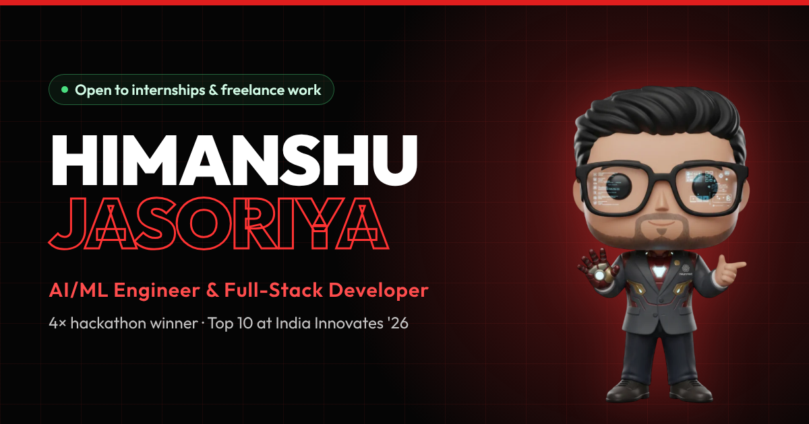

# Himanshu Jasoriya: Portfolio

Personal portfolio of **Himanshu Jasoriya**, AI/ML Engineer & Full-Stack Developer (B.Tech AI & Data Science).
4× hackathon winner and Top 10 at India Innovates '26 among 26,000+ participants.

**Live site:** https://portfolio-himanshu-jasoiya.vercel.app/



## Highlights

- Cinematic hero with mouse parallax and a scroll-linked 3D (CSS transform) character companion
- Project case studies with screenshot galleries and a keyboard-accessible lightbox
- Hackathon archive with a horizontal scroll timeline and real event photos
- Smooth scrolling (Lenis) and page transitions (Framer Motion) that respect "reduced motion"
- Responsive from 360px phones to wide desktops; WebP images with responsive `srcset`
- Contact form via Web3Forms with success/error states

## Tech stack

| Area | Tools |
| :--- | :--- |
| Framework | React 19, TypeScript, Vite 7 |
| Routing | React Router 7 (`BrowserRouter`) |
| Animation | Framer Motion, Lenis smooth scroll |
| Styling | Plain CSS per component |
| Icons | Lucide React |
| Hosting | Vercel (+ Vercel Analytics) |

## Getting started

```bash
git clone https://github.com/ItzHimanshu007/3d_portfolio_website.git
cd 3d_portfolio_website
npm install
npm run dev      # start the dev server
npm run lint     # ESLint
npm run build    # type-check + production build
npm run preview  # serve the production build locally
```

CI (GitHub Actions) runs lint and build on every push to `main` and on pull requests.

## Editing content

Most content lives in plain data files, so you rarely need to touch components:

| What | File |
| :--- | :--- |
| Name, role, summary, availability, email, phone, social links, résumé path, site URL | `src/config/site.ts` |
| Projects (copy, tech, screenshots, repo/live links, status) | `src/data/projects.ts` |
| Hackathons (results, photos, which 3 are featured, related project) | `src/data/hackathons.ts` |
| Experience & leadership | `src/data/experience.ts` |
| Certificates (section hidden while empty) | `src/data/certificates.ts` |
| Testimonials (section hidden while empty) | `src/data/testimonials.ts` |
| Education | `src/components/Education.tsx` |
| Skills | `src/components/Skills.tsx` |

Buttons for repo/demo/certificate links only render when a real URL is set.

**Images:** screenshots and photos are WebP in `public/projects` and `public/hackathons`, each as `name.webp`
(max 1600px wide) plus `name-800.webp`. Add both sizes for new images.

**Domain:** if the site URL changes, update `src/config/site.ts`, the canonical/Open Graph tags in `index.html`,
`public/robots.txt` and `public/sitemap.xml`.

## Project structure

```
src/
├── components/   # Page sections and shared UI (Navbar, Hero, Footer, Lightbox, ...)
├── pages/        # Routes: Home, Archive, HackathonArchive, ProjectDetail, HackathonDetail, NotFound
├── data/         # Projects, hackathons, experience, certificates, testimonials
├── config/       # site.ts: identity and links
├── hooks/        # useSectionNavigation
└── utils/        # scrolling, images, Lenis instance, scroll-companion timing
```

## Contact

- **Email:** [hjasoriya007@gmail.com](mailto:hjasoriya007@gmail.com)
- **LinkedIn:** [Himanshu Jasoriya](https://www.linkedin.com/in/himanshu-jasoriya/)
- **GitHub:** [ItzHimanshu007](https://github.com/ItzHimanshu007)
